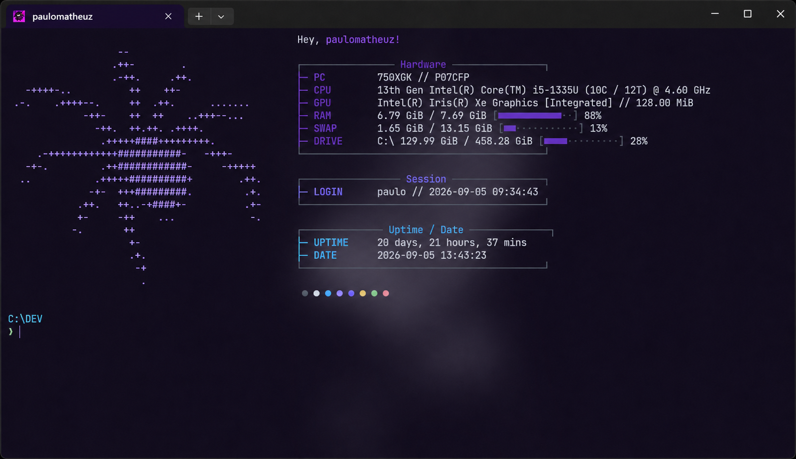

# winux-setup

Minhas configurações para Windows, reunidas em um só lugar para facilitar a instalação e a reprodução do meu ambiente em outros dispositivos.

O projeto começou como `custom-windows-terminal`, com a personalização do meu terminal. Agora, a proposta é incluir também o desktop, os atalhos e as automações que uso no dia a dia.



## Estado atual

O setup copia os arquivos do Fastfetch, integra o perfil do PowerShell e aplica opcionalmente minhas configurações do Windows Terminal, Starship, Komorebi, YASB, whkd e btop4win, com backup. A instalação opcional dos programas está disponível via WinGet; o Chuva (matrix-rain) tem instalação portátil própria. Fontes, recursos visuais e outras automações continuam nas próximas etapas.

## O que já está incluído

- temas, fonte, transparência e atalhos pessoais do Windows Terminal;
- Fastfetch com logo ASCII personalizada;
- perfil do PowerShell com os comandos pessoais dos dois perfis locais;
- integração com Starship e aplicação opcional da base do prompt;
- comandos como `clear`, `cls`, `Clear-Terminal`, `ls`, `ll`, `la`, `cd`, `btop` e `rain`;
- instalação opcional dos módulos z e PSReadLine.
- configurações pessoais do Komorebi, com layouts, regras de aplicativos e barra alternativa.
- configuração e CSS pessoais do YASB, com os valores privados do clima separados.
- atalhos pessoais do whkd, com shell PowerShell e integração com Komorebi.
- configuração pessoal e tema NeutralPurple do btop4win, com instalação opcional via WinGet.
- instalação opcional do matrix-rain, com os parâmetros pessoais do comando `rain`.

## Requisitos atuais

Para aplicar as configurações sem instalar programas, tenha os requisitos abaixo. A opção `-InstallPrograms` instala os programas do catálogo via WinGet:

- Git, para clonar o repositório;
- Windows Terminal;
- Windows PowerShell 5.1 ou PowerShell 7;
- Fastfetch;
- uma Nerd Font.

Starship, `lsd`, `z` e PSReadLine são opcionais. Os módulos podem ser instalados com `-InstallModules -AcceptAgreements`. Consulte o [perfil do PowerShell e suas dependências](docs/powershell.md).

## Como instalar a configuração atual

Clone o repositório:

```powershell
git clone https://github.com/paulomatheuz/winux-setup.git
cd winux-setup
```

Verifique os pré-requisitos:

```powershell
powershell -ExecutionPolicy Bypass -File .\setup.ps1 -Check
```

Simule a aplicação:

```powershell
powershell -ExecutionPolicy Bypass -File .\setup.ps1 -WhatIf
```

Aplique Fastfetch e PowerShell:

```powershell
powershell -ExecutionPolicy Bypass -File .\setup.ps1
```

O instalador copia os arquivos do Fastfetch e o perfil do projeto para `$HOME\.config\fastfetch`. Antes de substituir qualquer arquivo existente, salva seu conteúdo anterior em `$HOME\.winux-setup\backups`, junto de um registro das alterações. Arquivos idênticos não são regravados. Veja os [detalhes dos backups](docs/backups.md).

Sem `-InstallPrograms`, o setup aplica apenas a configuração atual do terminal. Para instalar os programas do catálogo e depois aplicar essa configuração:

```powershell
powershell -ExecutionPolicy Bypass -File .\setup.ps1 -InstallPrograms -AcceptAgreements
```

A opção `-AcceptAgreements` aceita os termos da fonte e dos pacotes. Consulte o [catálogo e as opções de instalação](docs/programas.md) antes de usar. As configurações de cada ferramenta são selecionadas separadamente com `-Components`.

Para aplicar apenas o Fastfetch, acrescente `-Components Fastfetch`. A opção `PowerShell` inclui os arquivos do Fastfetch usados pelo perfil. Consulte as [opções do setup](docs/setup.md) para os detalhes e a compatibilidade com o instalador anterior.

Depois, feche e abra novamente o Windows Terminal.

Para aplicar a base do prompt Starship com backup, use `-Components Starship`. O ambiente inventariado usa o visual padrão, sem uma configuração personalizada. Veja os [destinos e as opções do Starship](docs/starship.md).

Para aplicar as configurações pessoais do Komorebi, use `-Components Komorebi`. Veja os [destinos, a barra alternativa e os ajustes de monitores](docs/komorebi.md). O componente copia os arquivos sem iniciar o gerenciador de janelas.

Para aplicar a barra e o CSS do YASB, use `-Components Yasb`. Veja os [destinos, clima, wallpapers e fontes](docs/yasb.md). O arquivo `.env` local é preservado.

Para aplicar os atalhos, use `-Components Whkd`. Veja os [atalhos, destinos e aplicação conjunta do desktop](docs/whkd.md). Os oito atalhos de espaços de trabalho são preservados; a configuração do Komorebi mantém sete espaços.

Para aplicar o btop4win, use `-Components Btop`. A instalação opcional usa `-InstallPrograms -Programs Btop`. Veja os [destinos, modo TTY e opções do btop](docs/btop.md).

Para instalar o Chuva junto ao setup, acrescente `-InstallRain`. Veja [Chuva e o comando rain](docs/chuva.md) para a instalação isolada, os arquivos oficiais e as simulações.

## Tema do Windows Terminal

O esquema de cores está em:

```text
config/windows-terminal/settings.json.example
```

Para aplicar as preferências automaticamente, com backup e preservação dos perfis locais:

```powershell
powershell -ExecutionPolicy Bypass -File .\setup.ps1 -Components WindowsTerminal -Check
powershell -ExecutionPolicy Bypass -File .\setup.ps1 -Components WindowsTerminal
```

Esse componente é opcional e não exige Fastfetch. Veja os [destinos, a seleção da edição e as preferências preservadas](docs/windows-terminal.md). A fonte precisa estar instalada no dispositivo.

## Estrutura atual

```text
winux-setup/
├── assets/
│   └── screenshots/
├── config/
│   ├── btop/
│   ├── fastfetch/
│   ├── komorebi/
│   ├── powershell/
│   ├── starship/
│   ├── whkd/
│   ├── windows-terminal/
│   └── yasb/
├── docs/
│   ├── btop.md
│   ├── chuva.md
│   ├── backups.md
│   ├── estrutura.md
│   ├── inventario.md
│   ├── komorebi.md
│   ├── powershell.md
│   ├── programas.md
│   ├── starship.md
│   ├── setup.md
│   ├── whkd.md
│   ├── windows-terminal.md
│   └── yasb.md
├── scripts/
│   ├── btop.ps1
│   ├── configuration.ps1
│   ├── install-modules.ps1
│   ├── install-programs.ps1
│   ├── install-rain.ps1
│   ├── install.ps1
│   ├── komorebi.ps1
│   ├── starship.ps1
│   ├── whkd.ps1
│   ├── windows-terminal.ps1
│   └── yasb.ps1
├── tests/
│   ├── btop.tests.ps1
│   ├── configuration.tests.ps1
│   ├── komorebi.tests.ps1
│   ├── modules.tests.ps1
│   ├── powershell.tests.ps1
│   ├── rain.tests.ps1
│   ├── starship.tests.ps1
│   ├── whkd.tests.ps1
│   ├── windows-terminal.tests.ps1
│   └── yasb.tests.ps1
├── modules.psd1
├── packages.psd1
├── portable-programs.psd1
├── setup.ps1
└── README.md
```

A organização das pastas e os caminhos de instalação estão descritos em [Estrutura do projeto](docs/estrutura.md).

## Próximas etapas

As mudanças serão feitas aos poucos, em commits separados:

- [x] Inventariar as configurações e dependências do ambiente atual ([inventário](docs/inventario.md)).
- [x] Organizar as configurações e os scripts para receber os demais componentes.
- [x] Criar a entrada do setup com seleção de componentes, verificação de pré-requisitos e simulação.
- [x] Automatizar a instalação dos programas do catálogo via WinGet.
- [x] Aplicar as configurações com backup dos arquivos anteriores e registro das alterações.
- [x] Incorporar os comandos dos perfis pessoais do PowerShell e a instalação opcional dos módulos.
- [x] Incorporar as preferências pessoais do Windows Terminal e sua aplicação com backup.
- [x] Registrar a base atual do Starship e sua aplicação opcional com backup.
- [x] Incorporar as configurações pessoais do Komorebi, regras e barra alternativa.
- [x] Incorporar a configuração e o CSS pessoais do YASB, preservando o visual.
- [x] Incorporar os atalhos pessoais do whkd e a aplicação conjunta das configurações do desktop.
- [x] Incorporar a configuração e o tema do btop4win, com instalação opcional.
- [x] Adicionar a instalação portátil do Chuva e preservar os parâmetros do comando `rain`.
- [ ] Incluir fontes, temas e os recursos visuais necessários.
- [ ] Configurar a inicialização automática dos componentes.
- [ ] Permitir ajustes específicos por dispositivo.
- [ ] Permitir atualizar o ambiente executando o setup novamente e restaurar backups.
- [ ] Validar o setup em outro dispositivo e documentar o processo.

## Personalização

As configurações refletem meu uso pessoal. Você pode usá-las como base e adaptar temas, atalhos e ferramentas ao seu ambiente.

