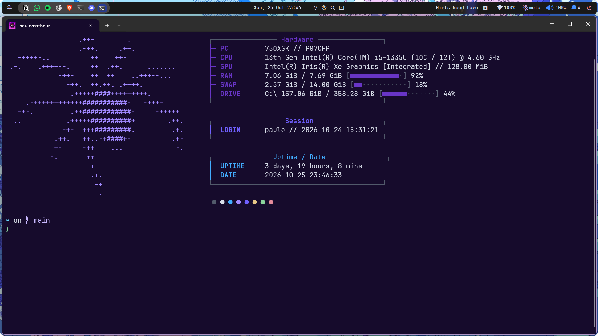
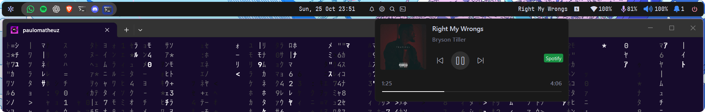
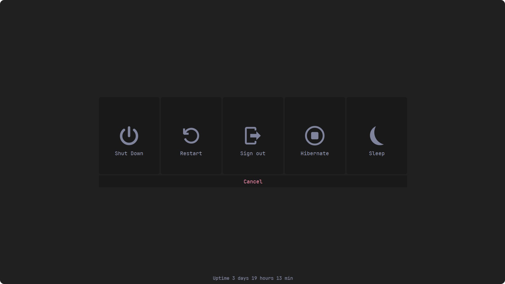

# winux-setup

Meu Windows, do desktop ao terminal.

[Desktop](#desktop) · [Terminal](#terminal) · [YASB](#yasb) · [Instalação](#instalação)

## Desktop


### Em uso


komorebi · whkd · btop4win · rain · spotify_player

## Terminal



Windows Terminal · PowerShell · Fastfetch · Starship

## YASB

### Wallpapers


### Mídia



### Energia



## Instalação

```powershell
git clone https://github.com/paulomatheuz/winux-setup.git
cd winux-setup
.\setup.ps1 -Check
```

Escolha os componentes e siga o [guia de instalação](docs/setup.md).

[Programas](docs/programas.md) · [Por dispositivo](docs/dispositivos.md) · [Backups](docs/backups.md) · [Validação](docs/validacao.md)
